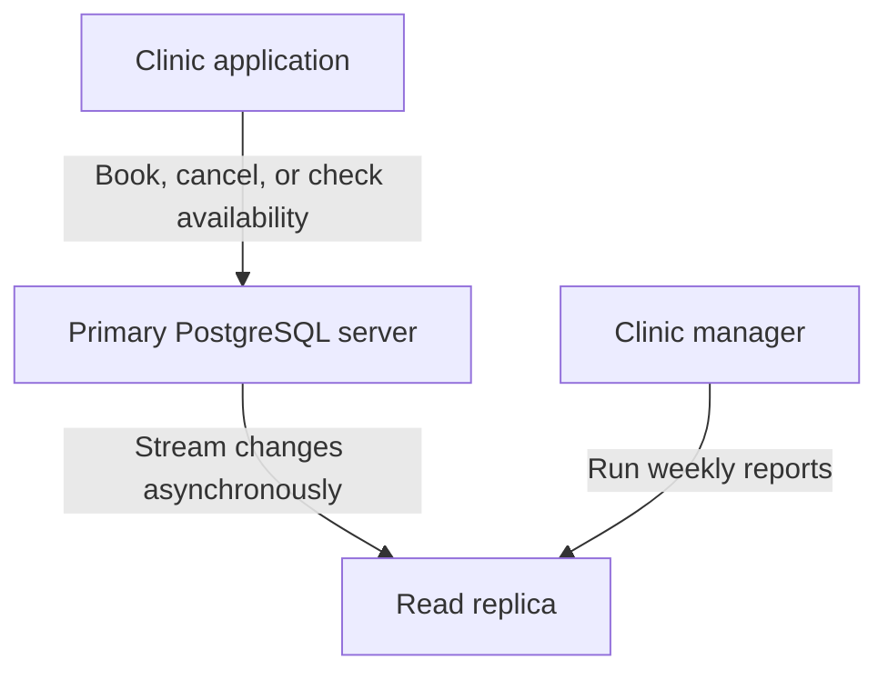

# Portfolio 5 — Distributed and Cloud Database Design

This is a proposed PostgreSQL setup for the simulated outpatient clinic.

## Normal operation

The primary server handles bookings, cancellations, and availability checks. It streams changes to a read replica. The clinic manager uses the replica for read-only reports, such as weekly appointment counts.

## Replica lag

The replica may take time to catch up. For example, a weekly report could briefly show a cancelled appointment as still booked. The booking application reads and writes on the primary, where the unique index tested in Portfolio 3 prevents two uncancelled bookings for the same slot.

## Primary failure

If the primary fails, the clinic pauses bookings until the standby is promoted and the application is redirected to it. With asynchronous replication, recent changes that had not reached the standby may be lost.

## References

- [PostgreSQL 18 documentation — Log-Shipping Standby Servers](https://www.postgresql.org/docs/18/warm-standby.html)
- [PostgreSQL 18 documentation — Hot Standby](https://www.postgresql.org/docs/18/hot-standby.html)
